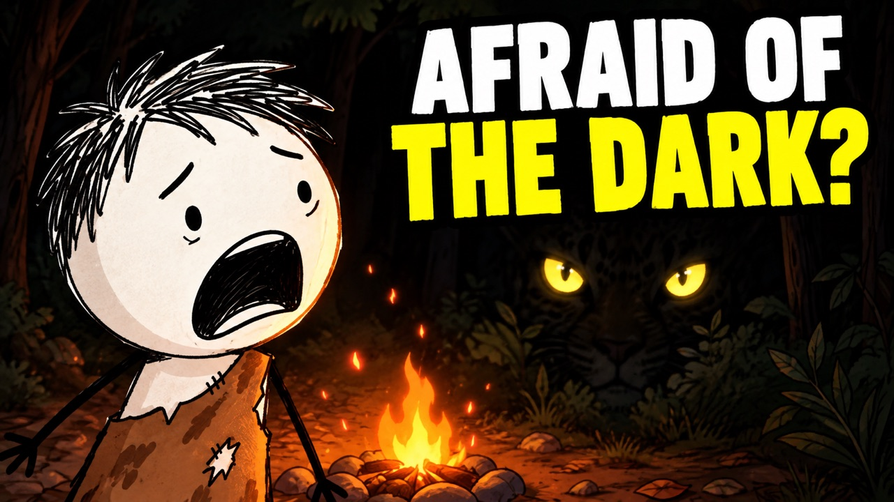
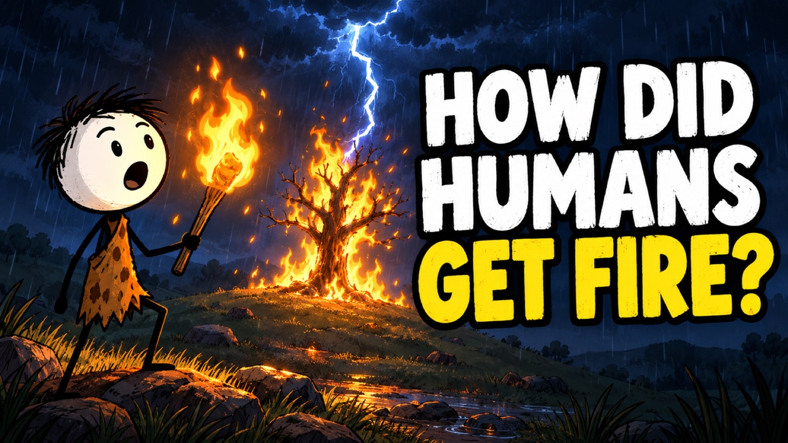
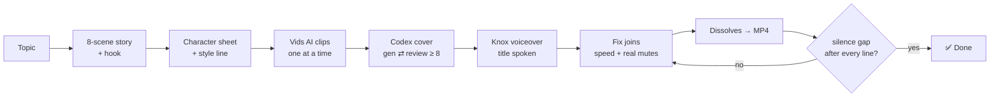

<div align="center">

# 🎬 Stickman Director

**One question in → one finished stick-figure explainer video out.**
A Claude skill that drives Google Vids end to end: story, AI clips, Codex title card, voiceover, export.

   

 

<sub>Title cards made by the skill: Codex image generation + a Codex review loop until it scores ≥ 8/10.</sub>

</div>

---

## What you get

You type a topic. Claude, alone, in your own browser:

| | Step | What happens |
|---|---|---|
| 1 | **Story** | 8 scenes, opens on the most surprising moment as a hook, one warm narration line per scene |
| 2 | **Character** | a locked character sheet + style line, pasted unchanged into every prompt → same hero in every shot |
| 3 | **Clips** | Google Vids AI video (Omni, 5 s, 16:9), generated one at a time, each checked, bad ones remade once |
| 4 | **Title card** | a thumbnail-grade cover from Codex, reviewed by Codex, used as scene 1 **and** spoken aloud as the hook |
| 5 | **Voice** | calm male storyteller (Knox), timed so no line runs into the next |
| 6 | **Finish** | clips muted, soft 0.5 s dissolves, MP4 export, automatic audio check |



## Install

**Claude Code plugin (one line):**

```
/plugin marketplace add rocketmandrey/stickman-director
/plugin install stickman-director@stickman-director
```

**Or just copy the skill:**

```bash
git clone https://github.com/rocketmandrey/stickman-director
cp -r stickman-director/skills/stickman-director ~/.claude/skills/
```

## Requirements

- **Google account with Vids AI video** (Workspace or Google AI Pro), signed in, in Chrome
- **Browser automation** for Claude - e.g. the [Claude in Chrome](https://claude.com/chrome) extension
- **[Codex CLI](https://github.com/openai/codex)** with image generation - for the title card
- **ffmpeg** - for the final audio check

## Use

```
Stickman Director: Why were ancient humans so scared of the dark?
```

Claude shows the story, then works without asking. At the end you get the MP4, the cover,
the Vids project link and a one-line summary per scene.

More topics that work well: *How did humans get fire? · Who invented the wheel? · Why do we need to drink water? · Why do guys usually make the first move?*

## Limits

| | |
|---|---|
| Generations | Vids shows **no counter**. Most plans ≈ **50 AI clips / month** ([Google help](https://support.google.com/docs/answer/16143507)); one video ≈ 8–10 |
| Clip length | 5 s per scene (slider defaults to 10 s - the skill sets 5) |
| Time | ≈ 45 s per clip, ~20–30 min per finished video |
| Safety | never types passwords; any sign-in / payment / error / "unusual activity" screen → stops and asks you |

## Hard-won lessons (baked into the skill)

- 🧑‍🦲 **Skin-coloured heads.** Omni drifts to skin tone → every prompt ends with *"The head is pure paper-white"*.
- 🗣️ **"The voice garbles at the cuts."** Dissolves eat 0.5 s of the next scene, so lines overlap.
  Fix: clip speed so each scene ≥ its voice + 0.8 s. Correct when all voice clips sit on **one row**.
- 🔇 **Mutes that un-mute.** Clicking the Mute checkbox from JS looks checked and reverts. Real clicks only, re-verified before export.
- 🖼️ **Title card is an image, not a text box** - and the title is read aloud. That's the hook.
- 💬 **"Add styled captions" tips** add captions if you click near them. Close with ✕.
- ✅ **Trust the file, not the UI:** `check_audio.sh` demands a silence gap after every line.

## Repo

```
skills/stickman-director/
├── SKILL.md              # the full playbook Claude follows
└── scripts/
    ├── cover_gen.sh      # Codex title card: generate → review → regenerate until ≥ 8
    ├── vids_helpers.js   # select scenes, transitions, mute coords, voice timings, file upload
    └── check_audio.sh    # ffmpeg silencedetect: a gap after every narration line
```

## License

MIT - copy it, fork it, make videos.
